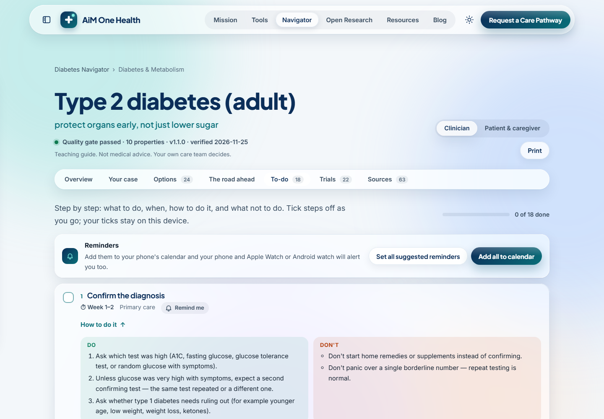
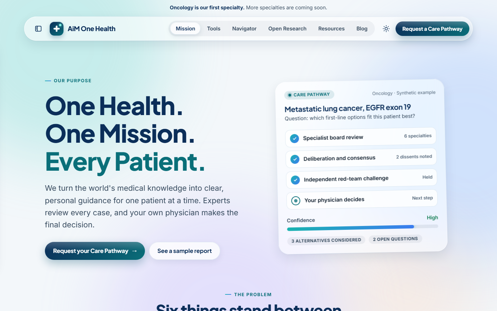
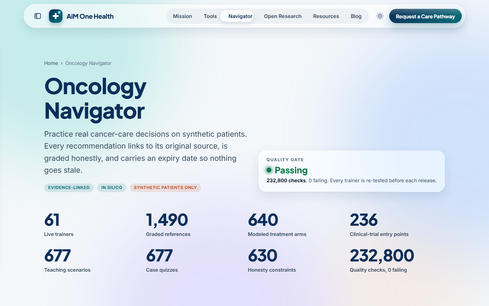
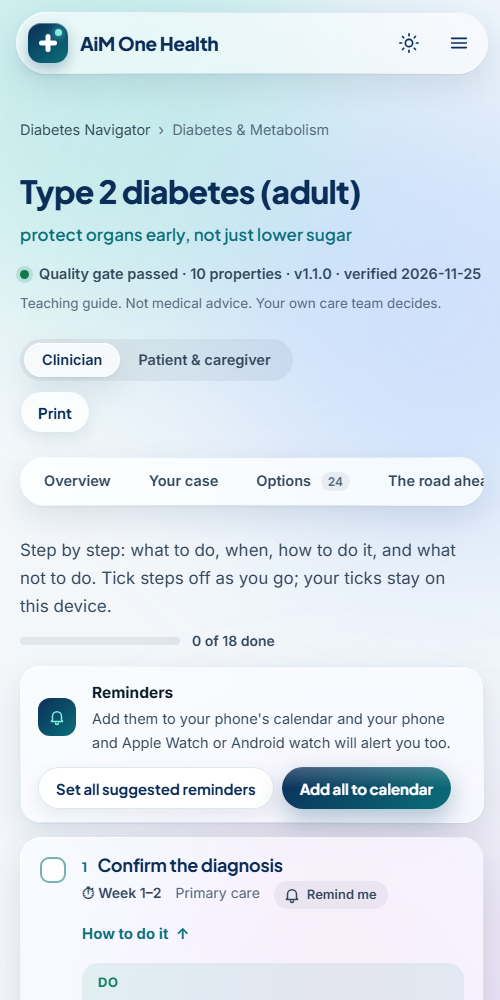
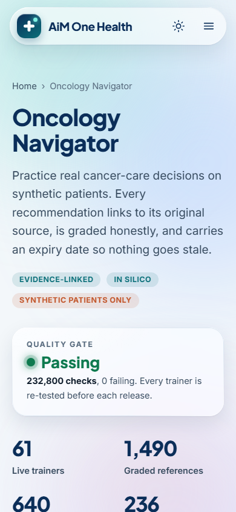

# AiM One Health · Navigator web app

**Live app: [altar1234.github.io/aim-one-health](https://altar1234.github.io/aim-one-health/)**

AiM One Health turns clinical guidelines and trial evidence into interactive teaching guides. Each guide shows the decision journey for a condition, which treatment options fit a described case, the clinical trials, the full source library, and a step-by-step to-do list with reminders. It installs on an iPhone as a home-screen app and works offline.

> Teaching and demonstration only. The patients are synthetic, and nothing here is medical advice.

## What it does

- **62 guides.** 61 cancer guides plus a new **type 2 diabetes** guide built from the ADA *Standards of Care in Diabetes 2026*, the 2026 ADA/EASD consensus, KDIGO, USPSTF and the landmark outcome trials. It has 24 options, 22 trials and 63 checked sources.
- **Your case.** Describe a case step by step. Every option is checked against its own eligibility rule and shown as *Fits*, *Doesn't fit* or *Depends*.
- **To-do list.** Each step says when to do it, who helps, how to do it, what *not* to do, and the sources behind it. Tick steps off as you go, with a progress bar.
- **Reminders.** Any step can have reminders: once, daily, weekly, monthly, every 3 or 6 months, or yearly. The guide suggests evidence-based timings, for example an A1C recheck every 3 months and yearly kidney, eye and foot checks. **Add all to calendar** creates calendar events with alerts, so an iPhone, Apple Watch or Android watch alerts you too.
- **Clinician and patient views.** One switch moves between precise clinical detail and plain language.
- **iPhone app.** Add it to the home screen from Safari and it runs full-screen with its own icon. A service worker keeps it working offline.
- **Liquid-glass design** with day and night themes and smooth page transitions.

## Screenshots

| Home | Navigator search |
| --- | --- |
|  |  |

| iPhone: guide and to-do list | iPhone: Navigator |
| --- | --- |
|  |  |

## Install on iPhone

1. Open the [live app](https://altar1234.github.io/aim-one-health/) in **Safari**.
2. Tap **Share** → **Add to Home Screen**.
3. Open a guide → **To-do** → **Set all suggested reminders** → **Add all to calendar** for alerts on your phone and watch.

## How it's built

- **Front end:** plain HTML, CSS and JavaScript, with no framework and no build-time dependencies. The guides are JSON files rendered on the client.
- **Eligibility engine:** a small expression parser (no `eval`) evaluates each option's rule, for example `egfr>=20 && hf=='yes'`, against the case. It returns three values, so a missing input gives *Depends* rather than a wrong answer.
- **Reminders:** a recurrence engine computes the next due time, and an iCalendar (`.ics`) export carries `RRULE` repeats and `VALARM` alerts, so calendars and watches handle notifications natively.
- **Offline / installable:** a web app manifest plus a stale-while-revalidate service worker.
- **Transitions:** cross-document View Transitions, with a short fade-and-glide between pages.
- **Desktop companion (not in this repo):** an Electron app adds Windows notifications for reminders and **Ask AI**, a study assistant. It answers only from the open guide's data, cites the sources it used, offers follow-ups, and has *Simple / Extra / Full on* detail levels.

This repository holds the **published build** of the web app. The development source is kept separately.

## Evidence and honesty rules

Every guide carries its own honesty rules and safety gates. Sources are numbered and linked. Statuses that couldn't be verified are labelled rather than presented as current, and claims that couldn't be traced to a source were left out.
